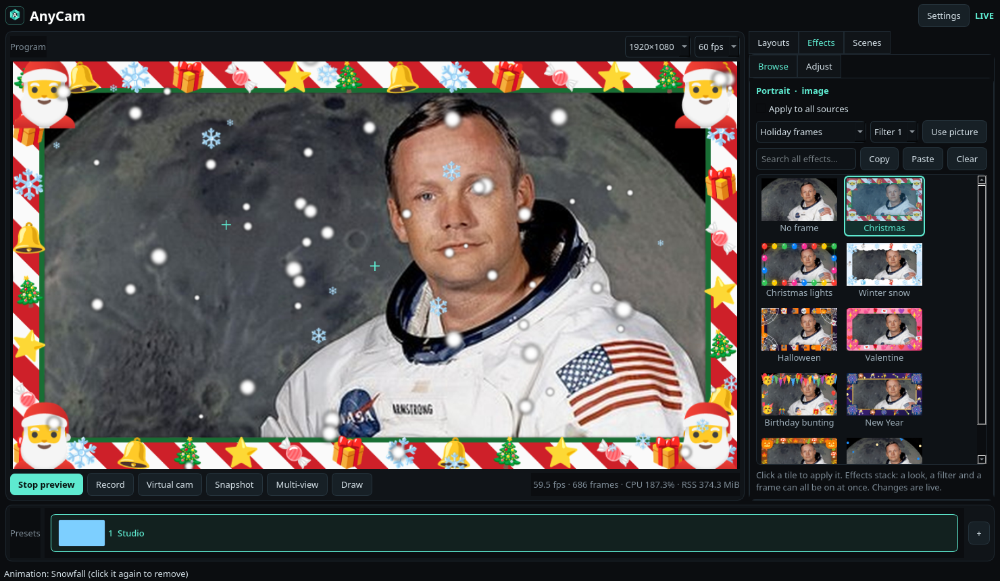

# AnyCam

**A Linux-native virtual camera studio.** Mix webcams, screens, phones, images, video and
overlays into scenes, add filters, face masks, frames and animations, and send the result to
Discord, Chrome, OBS, a recording or a live stream. Clean-room: no ManyCam code or assets,
no Wine.



## What it does

- **Scenes and layers.** Cameras, screen shares, images, video, network streams, text,
  tickers, lower thirds, clocks, timers, GIFs, drawings and PDF slides, each a layer you can
  drag, resize, crop, rotate, flip, zoom, fit (contain, cover or stretch), lock, reorder and
  undo. Scenes switch live without rebuilding the picture, with a cut, fade, slide or wipe,
  and **Studio mode** lets you stage the next scene and take it with Cut or Transition.
- **Effects.** About 90 filters and effects (colour looks, RGB levels, distortions, retro
  TV, touch-up, background blur and replace, spotlight, auto-frame, rounded corners), 22 face
  masks, 32 themed frames, 42 animations, emoji, virtual backgrounds and 36 stage
  backgrounds. A thumbnail browser applies them live, two filters stack per layer, and you can
  star favourites and install third-party [effect packs](docs/EFFECT_PACKS.md).
- **AI.** Person cut-out, face tracking and masks run on ONNX Runtime, on the CPU or an
  NVIDIA GPU. MediaPipe segmentation is bundled; Robust Video Matting is a verified,
  one-click download. See [docs/EFFECT_MODELS.md](docs/EFFECT_MODELS.md).
- **Audio.** A mixer with a meter for every input and the output: microphone with noise
  suppression, gate, compressor and EQ presets; desktop audio; background music with loop,
  shuffle and a playlist; the sound of video layers; a sync offset per source; a monitor
  output; and a virtual microphone that other apps can record.
- **Outputs.** A V4L2 virtual camera (optionally also a PipeWire camera node), MP4
  recording, and live streaming to several RTMP, RTMPS or SRT destinations at once from one
  encode, each with its own status and automatic reconnect. Encoder: NVENC, VA-API or x264,
  chosen by a real test encode.
- **Phone as a camera and a remote.** Scan a QR code and the phone streams into a scene over
  WebRTC; a paired phone can also switch scenes, mute and record from `/remote`.
- **Desktop.** A tray icon, global shortcuts through the desktop portal, remappable
  keyboard shortcuts, a floating always-on-top panel with a round preview, motion detection
  that can switch scene and notify you, German and English, and accessible names on every
  control.

## Quick start

```bash
pip install anycam-1.4.0.tar.gz     # from the GitHub release, or from a checkout:
./scripts/setup.sh                  # creates .venv with system site-packages
./scripts/anycam-gui                # the studio (or: python -m anycam gui)
./scripts/install-desktop.sh        # optional: add it to the app menu
```

On first launch AnyCam shows a checklist of what works on your machine and the exact
command to fix what does not. Run it any time with `anycam check`, or from **Settings →
General → Check this computer**.

Packaging recipes for Debian/Ubuntu, Arch, Flatpak and AppImage are in
[packaging/](packaging/).

## Requirements

Developed on CachyOS (Arch), KDE/Wayland, NVIDIA, GStreamer 1.28, and used by the author with a
real webcam as a virtual camera in Discord and Telegram. The automated tests use synthetic
sources and the offscreen GUI; raw measurements are in [docs/EVIDENCE.md](docs/EVIDENCE.md).

- Python 3.11+ and GStreamer with `base good bad ugly libav opengl pulse`
- PyGObject (from your distribution, not PyPI)
- PySide6 matching your system Qt (`pip install 'anycam[gui]'`), `numpy`, `Pillow`, `psutil`
- `onnxruntime` for portrait and face effects (`anycam[face]`; the models are bundled), or
  `onnxruntime-gpu[cuda,cudnn]` to run them on an NVIDIA GPU
- `xdg-desktop-portal` + PipeWire (screen capture), `ffmpeg`, `v4l-utils`
- `v4l2loopback` for the virtual camera (AnyCam sets it up on first launch, one password)
- Optional: `poppler` (PDF slides), `yt-dlp` (video-site links), `cryptography` and `segno`
  (phone camera certificate and QR code, `anycam[phone]`), `notify-send` (motion alerts)
- Optional GPU preview: `gst-plugin-qml6` with the **distribution's** PySide6. pip's PySide6
  bundles its own Qt, which the plugin refuses to load against, so with it AnyCam keeps the
  CPU preview

```bash
sudo pacman -S --needed python pyside6 python-gobject gst-plugins-{base,good,bad,ugly} \
  gst-libav gst-plugin-opengl gst-plugin-qml6 ffmpeg v4l-utils pipewire-pulse \
  xdg-desktop-portal python-numpy python-pillow python-psutil
```

**GPU preview.** When `qml6glsink` loads, frames go from GStreamer straight into a texture
and the window only composites. On the reference machine at 1080p60 that halved the window
thread (median 40–47% → 18–20% of a core). The log says `preview: GPU preview (qml6glsink)`
when it is in use; `ANYCAM_PREVIEW=image` forces the CPU preview.

**GPU canvas.** **Settings → Output → Mix layers on: Automatic** mixes the layers with
`glvideomixer` when a test frame through upload, mix and download comes back right;
otherwise, or with **CPU**, the `compositor` element does it. If a GPU canvas fails to
start, AnyCam switches to the CPU for the rest of the session. `ANYCAM_CANVAS=cpu|gpu`
overrides the setting. RGB levels run only on the GPU canvas.

## Virtual camera

On first launch AnyCam offers a one-time setup (one password prompt). It writes
`/etc/modprobe.d/anycam.conf` (`video_nr=10 card_label=AnyCam exclusive_caps=1`),
`/etc/modules-load.d/anycam.conf` (load at boot) and `/etc/udev/rules.d/70-anycam-vcam.rules`,
then reloads the driver. `exclusive_caps=1` is what Discord, Vesktop and Chrome need to
list the camera; the udev rule lets AnyCam re-announce the device without root each time it
starts writing. After that, opening AnyCam is enough: the camera is held from launch with a
standby picture and follows the preview. Remove the three files to undo.

If the session has no polkit agent running, AnyCam starts the installed one for the prompt.
**Settings → Diagnostics** shows the state and repeats the setup;
`scripts/enable-v4l2loopback.sh` does the same from a terminal.

**PipeWire camera (optional).** **Settings → Output → Publish as** can also publish the
camera as a PipeWire node named "AnyCam", or only that node. It needs no driver, no root and
no setup, and is offered through the camera portal like a real webcam. Browsers list
PipeWire cameras only with their switch on: Firefox `media.webrtc.camera.allow-pipewire` in
`about:config`; Chrome and Chromium-based apps `--enable-features=WebRtcPipeWireCamera`
(Vesktop reads extra flags from `~/.config/vesktop-flags.conf`). Apps that only open
`/dev/video*` never see it, so the loopback device stays the default.

## Recording and streaming

Recordings go to `~/Videos/AnyCam/` (or the folder in **Settings → Output → Recording**),
as one MP4 across scene changes. Set a video bitrate there, and a free-space limit: when the
disk gets that low, the recording is stopped and saved instead of being lost.

**Settings → Stream** takes a YouTube, Twitch, Facebook or Kick preset plus your stream key,
or any `rtmp://`, `rtmps://` or `srt://` address, and a list of extra destinations that
receive the same encode. Each destination shows `connecting`, `live`, `reconnecting` or
`failed`; a dropped connection is retried after 1, 2, 4 … 30 seconds without touching the
recording or the other destinations.

Headless, no window:

```bash
python -m anycam demo --seconds 60 --source camera --audio --record ~/Videos/AnyCam/s.mp4
python -m anycam demo --seconds 30 --source camera --rtmp rtmp://127.0.0.1:1935/live/anycam
```

## Phone camera and remote

**Add → Phone camera (QR code)** shows a QR code. Scan it, accept the one-time certificate
warning, allow the camera, and the phone streams into the scene over WebRTC. It stays on
your local network; there is no app to install and a paired phone reconnects by opening the
page again. If ufw or firewalld blocks the port, **Allow phones** opens it with one password
prompt. The certificate and QR code come from `cryptography` and `segno` (`anycam[phone]`),
or else the `openssl` and `qrencode` commands.

Turn on **Settings → General → Phone remote** and a paired phone can open `/remote` on the
same address to switch scenes, mute the microphone and start or stop recording. It is off
until you switch it on, only paired phones can use it, and it can only do those three
things. Details: [docs/PHONE_CAMERA.md](docs/PHONE_CAMERA.md).

## Command line

| Command | What it does |
|---|---|
| `anycam gui` | the studio |
| `anycam demo` | headless camera → composition → MP4, virtual camera or RTMP |
| `anycam check` | the first-run checklist: what works, and the command that fixes the rest |
| `anycam doctor` | machine-readable prerequisites, including measured conversion cost |
| `anycam elements` | list missing GStreamer elements |
| `anycam sources` | list cameras and microphones |
| `anycam probe` | print the detected system and devices as JSON |
| `anycam soak` | long-run acceptance test (drops and memory) |

## Keyboard shortcuts

Defaults, all remappable in **Settings → General**: `Ctrl+P` preview, `Ctrl+R` record,
`Ctrl+Shift+V` virtual camera, `F5` snapshot, `Ctrl+M` mute, `Ctrl+1…9` scenes, `Ctrl+]` /
`Ctrl+[` next / previous scene, `Ctrl+Z` / `Ctrl+Shift+Z` undo / redo, `Ctrl+D` duplicate,
`Ctrl+L` lock, `Ctrl+Alt+arrows` align. Global shortcuts that work while other apps have
focus go through the desktop portal (KDE, Hyprland): `Ctrl+Alt+1…9` scenes,
`Ctrl+Alt+N` / `P` next / previous, `Ctrl+Alt+M` mute, `Ctrl+Alt+R` record,
`Ctrl+Alt+V` virtual camera.

## Privacy

Everything stays local: no telemetry, no accounts, no update checks. Privileged changes are
the one-time virtual camera setup and, only if you click **Allow phones**, a ufw or
firewalld rule for TCP 8443; both go through the normal password prompt. The phone link
runs only after you add a phone (or open a scene with one): HTTPS on your LAN address,
pairing by single-use QR code, phone secrets stored hashed, video never leaves the network.
The only internet requests AnyCam makes are ones you start: the optional model download in
**Settings → Output → AI effects** (checked against a pinned SHA-256), a video-site link resolved by
`yt-dlp`, and the streams you publish. Screen capture asks permission through the portal.
Effect packs are third-party code and always run in a separate worker process.

## Known limitations

- **Not built:** a web page source (needs QtWebEngine), window capture for games, NDI,
  whiteboard region blur, several virtual cameras at once, and removing paired phones from
  the UI (delete `~/.local/state/anycam/phones.json`).
- **Tested without the hardware:** the virtual microphone and monitor output are checked as
  graphs and properties, not recorded by another app; RTMP and SRT are tested against local
  `ffmpeg` receivers, not against real platforms or `rtmps://` TLS; the GPU canvas could not
  be started in the test environment, so RGB levels and GPU pixel output are untested; the
  CUDA path is covered with a simulated provider only; VA-API with simulated hardware.
  [PARITY.md](PARITY.md) lists each claim with its evidence and gap.
- **Packaging:** the `.deb` is built and inspected by the tests; the PKGBUILD, Flatpak
  manifest and AppImage script are parsed and cross-checked but not yet built with their own
  tools.
- **Effects:** every effect fits a 1080p60 frame on the reference machine, but they still
  use CPU on worker threads as well as per frame. AI effects run in-process by default
  because the worker costs about 21–27 ms per 1080p frame; **Settings → Output → AI effects** can
  isolate them. Masks are 2D, built from five face landmarks: no depth and no expression
  tracking. Robust Video Matting is GPL-3.0, so it is a download, not bundled.
- **Microphone:** noise suppression removes steady noise (fans, hum, hiss), not keyboard
  clicks or voices, and there is no echo cancelling. Changing it restarts the canvas.
- **Canvas:** one canvas size and FPS for all layers, two filter slots per layer, and one
  virtual camera. Most scene and layer changes reposition pads without rebuilding the graph;
  structural changes rebuild it and start a new recording segment. Studio mode stages a
  scene by name, not with a second preview.
- **Virtual camera:** with `exclusive_caps=1`, Chromium apps list AnyCam only while AnyCam is
  running. An app that was already open when AnyCam started may need its camera list
  reopened. The setup will not reload the driver while another app's v4l2loopback camera
  (OBS, for example) exists, or while an app has the camera open.
- **Phone camera:** video only (no phone audio). The phone shows a certificate warning the
  first time, and again whenever its browser forgets the exception: the certificate is
  self-signed because a LAN address cannot get a public one. Same Wi-Fi only, no internet
  relay. Tested on one Android phone (Pixel 10) in Chrome. With plain nftables or another
  firewall, allow TCP 8443 yourself.
- **Devices:** a camera that returns under a different `/dev/video*` name must be
  re-selected. Screen share asks the portal chooser each launch, and a static share can show
  `SLOW`.
- NVIDIA Broadcast and the Maxine SDK are not used (Windows-only app; restrictive SDK
  licence). The AI effects run through onnxruntime instead.

## Releases

**v1.4.0** is the current version; **Settings → About** shows the version and what it runs
on. Pushing a `vX.Y.Z` tag runs `.github/workflows/release.yml`: it builds the tarball and
wheel, checks the bundled assets, smoke-tests a clean install and publishes a GitHub Release
with `SHA256SUMS`. To release, bump `version` in `pyproject.toml` and `VERSION` in
`src/anycam/config.py`, commit, then `git tag vX.Y.Z && git push origin vX.Y.Z`.
See [CHANGELOG.md](CHANGELOG.md).

## Develop

```bash
scripts/setup.sh                    # venv, packages, checks the GStreamer elements
scripts/test.sh                     # the whole suite (1251 tests), Qt offscreen
scripts/test.sh --no-hardware       # hides cameras, loopback, audio server and portal, like CI
ruff check src                      # defect rules only
python scripts/bench_canvas.py      # CPU per frame of each layer kind, relative to a baseline
python scripts/compat-matrix.py     # which browsers see and open the AnyCam camera
```

`.github/workflows/ci.yml` runs the suite on Ubuntu 24.04 with system GStreamer and no
camera, loopback device, display or desktop portal, so hardware-only tests skip there. It
runs twice: `test` on the bare runner and `test-no-hardware` with the masking switch on. To
reproduce it, run the workflow's steps in an `ubuntu:24.04` container (or `act -j test`);
the package list is in `.github/workflows/ci.yml`, and note that `gst-inspect-1.0 textoverlay`
needs `gstreamer1.0-x`, without which every standby chain fails.

[CONTRIBUTING.md](CONTRIBUTING.md) covers the rules for changes, [SECURITY.md](SECURITY.md)
how to report a problem.

## More

[PARITY.md](PARITY.md) (feature matrix with evidence), [TODO.md](TODO.md) (open work),
[docs/](docs/) (evidence, regressions, phone camera, effect models, effect packs, upgrade
plan), and the `NOTICE.md` files in `src/anycam/assets/models/` and
`src/anycam/assets/emoji/` for third-party assets and licences.

MIT licence. Emoji: Google Noto Emoji (Apache-2.0). Face detector: YuNet (Apache-2.0).
Segmentation: MediaPipe selfie segmentation (Apache-2.0).
